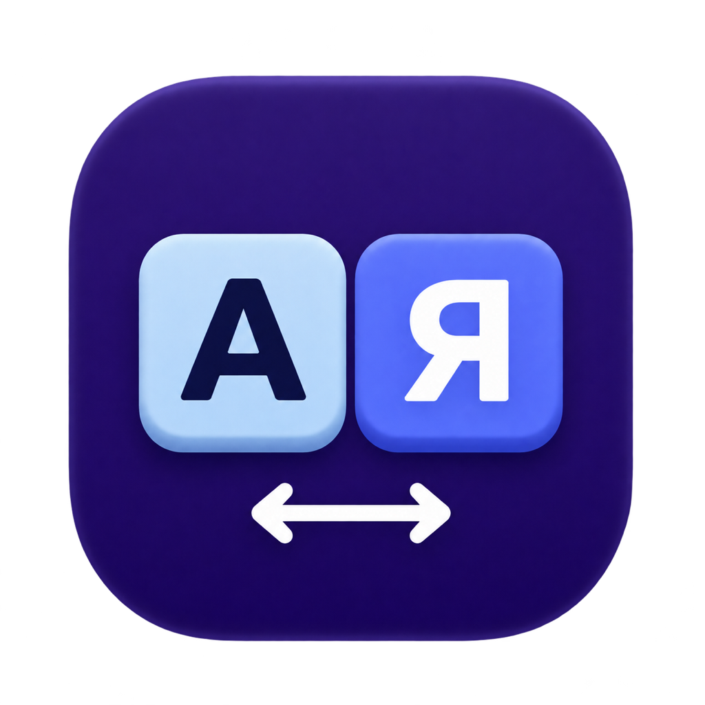

# LangSwitcher



Fix text typed with the wrong keyboard layout on macOS. Type `ghbdtn`, then tap and release **left Option (⌥)**. LangSwitcher replaces it with `привет` and switches your keyboard to Russian so you can keep typing.

LangSwitcher lives in the menu bar and runs on demand. It uses the keyboard layouts already enabled in macOS.

## Build and install

You need an **Apple silicon Mac** running **macOS 13 or later** and Xcode or Xcode Command Line Tools with **Swift 6**.

```sh
git clone https://github.com/maksimchernev/LangSwitcher.git
cd LangSwitcher
bash scripts/build.sh
```

1. Move `dist/LangSwitcher.app` to **Applications** and open it.
2. Choose **Разрешить работу…** (Request Access) in the LangSwitcher menu and enable LangSwitcher in **System Settings → Privacy & Security → Accessibility**. If macOS skips the prompt, use **Открыть настройки доступа…** (Open Permission Settings) to get to the right page.
3. If the menu says it still needs keyboard access, choose **Request Access** again and enable LangSwitcher under **Privacy & Security → Input Monitoring**, then quit and reopen it.
4. Make sure at least two keyboard layouts are enabled under **System Settings → Keyboard → Text Input → Edit**. The **Системные раскладки** (System Layouts) submenu lists the layouts LangSwitcher can use.

The app is signed locally during the build. After replacing an older build, quit it and open the new copy. If macOS still reports missing access, remove the old LangSwitcher entry from Accessibility and add the new app. Menu labels are currently in Russian. Look for **⌥↔** in the menu bar.

## Use it

| To fix… | What to do |
| --- | --- |
| The last word you typed | Tap and release left Option. Spaces you already typed after the word stay in place. |
| Part of a word, a phrase, or multiple lines | Select the text first, then tap left Option. |
| The same text again | Tap left Option again before editing or leaving the field. With two layouts, this restores the original text and input language. |

With more than two layouts, repeated taps cycle through the layouts that change the text. Option shortcuts such as **⌥←** still work as usual. Use **Клавиша исправления** in the menu to change the shortcut, or **Запускать при входе** to start LangSwitcher at login.

## Compatibility and privacy

LangSwitcher edits fields that let macOS Accessibility read and replace text. Some editors and browser fields may not support replacement, and formatting behavior varies by app. Password fields, secure input, and composition-based input methods are skipped.

Text is processed on your Mac. Recent input is held in memory while the field is focused. LangSwitcher does not write typed text to disk or change the clipboard.

## Checks

```sh
bash scripts/check.sh
dist/LangSwitcher.app/Contents/MacOS/LangSwitcher --diagnose
```

The checks cover word boundaries, shortcut handling, and layout conversion. The diagnostic command prints the active layout, available layouts, and Accessibility status. If a particular app has trouble, include its name, your macOS version, and a sample you can share when [opening an issue](https://github.com/maksimchernev/LangSwitcher/issues/new).
